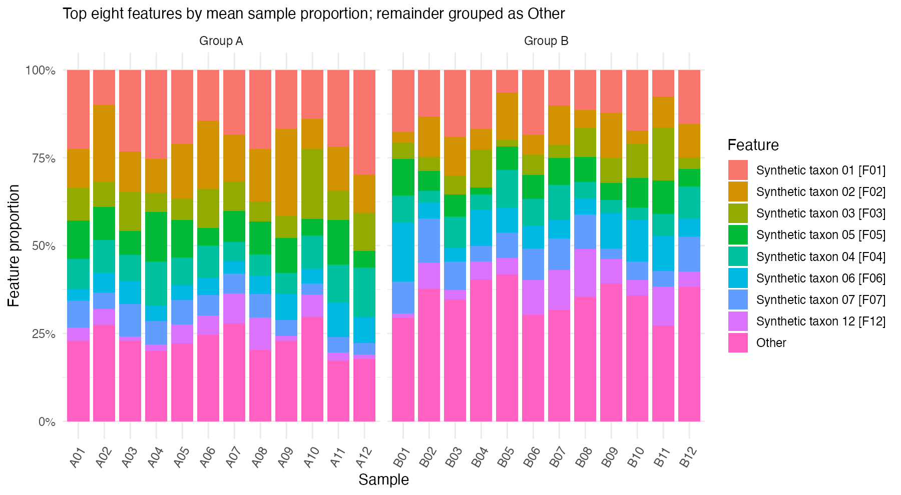
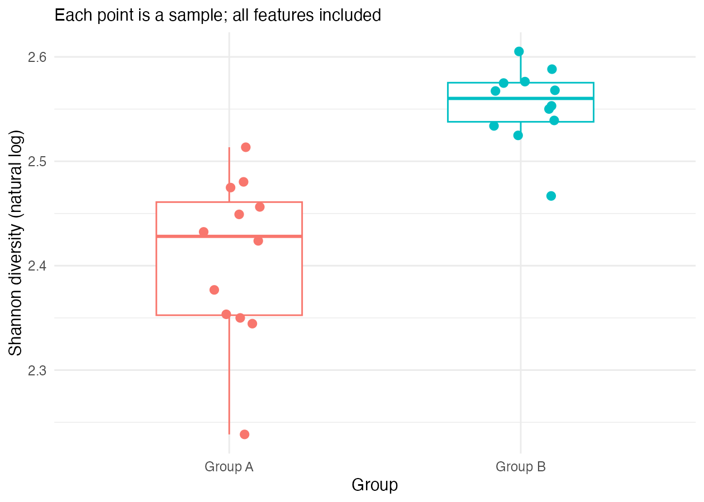
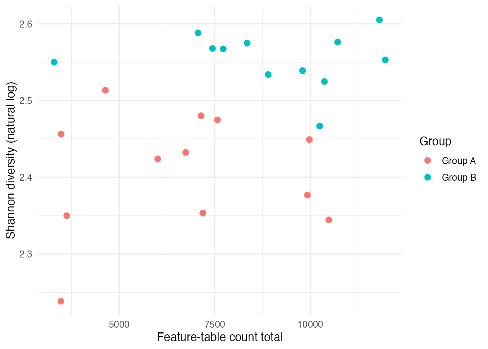

Use the [practice command](../../01-run-the-workflow.qmd#practice) to generate the outputs.

Each bar sums to 100%. Compare the same feature across samples. Other pools seven features, so inspect the unpooled table before attributing its difference to any one feature.

Each point is one sample. Compare the medians, spread, and overlap, then check the numerical values in the diversity table.

Look for a relationship within each group. Record whether the count ranges overlap before explaining the diversity difference.

[Next — Meet the data](02-meet-the-data.qmd)
