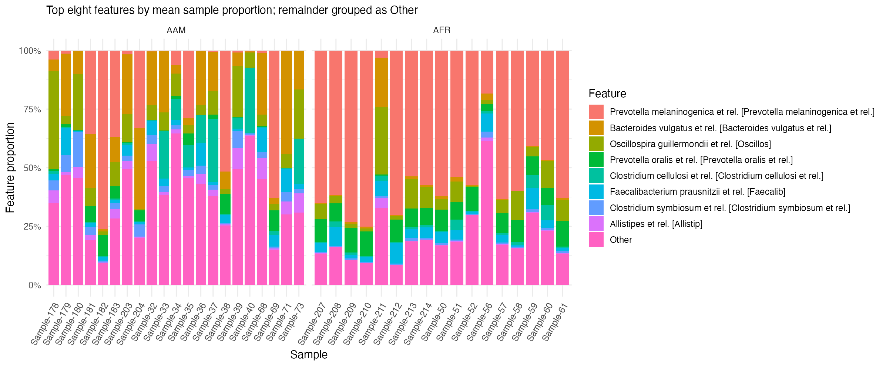
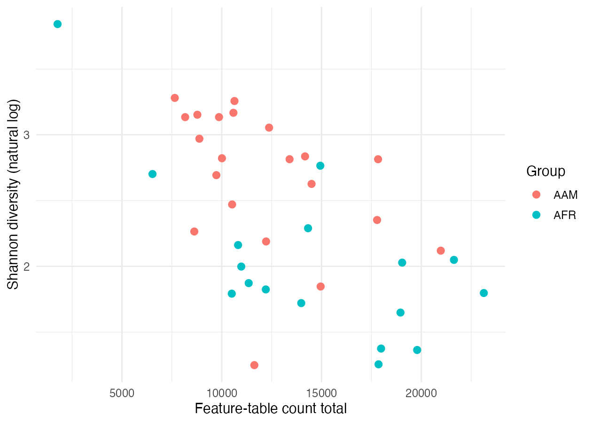
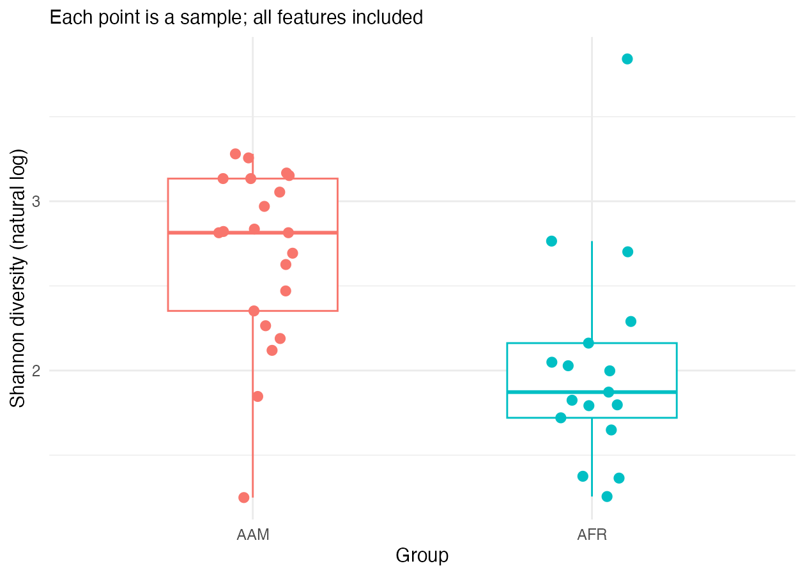

# Verify and explain

## Your task

Check that the saved results for **A01** can be reproduced from its original counts.
The analysis script uses `vegan::diversity()`; you will calculate Shannon diversity
step by step and compare the answers.

| Output column | Meaning | Expected A01 value in the supplied example |
|---|---|---:|
| `feature_total` | Sum of the feature counts | 6006 |
| `observed_features` | Number of features with a count greater than zero | 15 |
| `shannon` | Diversity reflecting richness and evenness, using natural logarithms | 2.423797 |

These values describe the supplied synthetic example. Your own data will give different results.

## Generate the results first

Run this in the **terminal**, from the repository root:

```bash
Rscript scripts/R/02-analyse-example.R
```

The script validates the inputs and writes `results/tables/alpha-diversity.tsv`.
It also checks that the direct Shannon formula agrees with vegan for every sample.

## Check one sample yourself

From the repository root, run this command in your **terminal** at the shell prompt:

```bash
Rscript scripts/R/05-verify-sample.R
```

The script checks **A01** by default. Open `scripts/R/05-verify-sample.R` in your
editor to follow the calculation.

1. Add the counts for A01 and count how many features have a positive count.
2. Divide each feature count by the sample total to get its proportion.
3. Use the positive proportions to calculate Shannon diversity with natural logarithms.
4. Compare all three results with the saved row for A01.

## Expected output

All three rows should show `TRUE` in `agrees`. For the supplied example,
Shannon diversity rounds to **2.423797**. Compare the unrounded values in code;
small rounding differences in displayed tables are normal.

If a check fails, confirm that you used the same input folder, output folder,
and sample ID as the analysis. Rerun the analysis after changing an input table.

::: {.cdi-message}
**From output to evidence**

You have reproduced one sample's summaries from its counts and compared them
with the saved results. You can now explain how those numbers were obtained.
:::

## Practice with the study dataset

Open `data/my-study/sample-metadata.tsv` and find the four IDs in the `sample_id` column. From the repository root, run the analysis and verify each sample.

```bash
Rscript scripts/R/02-analyse-example.R data/my-study results/my-study
Rscript scripts/R/05-verify-sample.R data/my-study results/my-study Sample-32
Rscript scripts/R/05-verify-sample.R data/my-study results/my-study Sample-181
Rscript scripts/R/05-verify-sample.R data/my-study results/my-study Sample-71
Rscript scripts/R/05-verify-sample.R data/my-study results/my-study Sample-214
```

Find **Sample-32** in `feature-counts.tsv`. Sum its counts and count the positive entries. Divide each positive count by the total to obtain its proportion, then use those proportions to calculate Shannon diversity.

::: {.callout-tip collapse="true"}
## Check your answer

| Sample ID | `group` | `study_group` | Total counts | Observed features | Shannon diversity |
|---|---|---|---:|---:|---:|
| Sample-32 | AAM | ED | 10585 | 103 | 3.167035 |
| Sample-181 | AAM | ED | 17784 | 100 | 2.352228 |
| Sample-71 | AAM | ED | 10521 | 102 | 2.470335 |
| Sample-214 | AFR | ED | 19040 | 103 | 2.028307 |

All three checks should show `TRUE` in `agrees` for each sample. Calculate Shannon diversity as $H = -\sum_{i=1}^{S} p_i \ln(p_i)$, where $S$ is the number of observed features and $p_i$ is the proportion for feature $i$.

Sample-32 and Sample-214 each have 103 observed features. Sample-32 has the higher Shannon value. With richness held equal, this reflects a more even distribution of counts across its observed features. Inspect the proportions to see how the samples differ.
:::

## Repeat with your own data

Use a separate folder for your input tables and a separate output folder.
Run the analysis first, then use those same folders and a sample ID from
your count table when you run the verification script.

::: {.callout-note}
Shannon diversity uses **all original features**. The top-eight features and
“Other” grouping simplify only the composition plot. Checking the arithmetic
does not establish a biological difference between groups or validate the study design.
:::

## Explain the figures

These figures are generated by the `data/my-study/` analysis above.



Compare the proportions of the same taxa across samples. The “Other” category pools taxa for display, so use the underlying table to see which taxa contribute to it.



Check whether samples with higher count totals also tend to have higher diversity. Sample-214 had more counts than Sample-32 (19,040 vs. 10,585) but lower Shannon diversity. Use the full plot to judge whether there is an overall pattern.



Compare the spread and overlap of the values across groups. Sample-32 and Sample-214 both had 103 observed features, but Sample-32 had higher Shannon diversity (3.17 vs. 2.03), reflecting greater evenness in its feature counts. This comparison describes two samples.


1. What varies within and between groups?
2. Do diversity values overlap?
3. Could count totals, filtering, or study design affect interpretation?
4. Which claims cannot be supported?

## Use AI to review your interpretation

Inspect the figures and tables first. Then supply the relevant outputs to your AI assistant with this prompt:

> I am comparing community composition and diversity between two groups using 24 synthetic samples and 15 fictional features. Using only the figures and tables I supply, help me describe the patterns in composition, diversity, and count totals. Check whether your descriptions agree with the numerical values. Identify limitations and questions I should investigate. Do not invent results or claim statistical significance or causation from visual differences alone.

For your own study, replace the sample and feature details with your actual study information.

Compare the response with the outputs. Check group labels, numerical values, and figure axes. Count totals describe the supplied counts; they do not by themselves measure absolute microbial abundance.

In `results/decision-log.md`, record briefly:

- **AI suggested:** the explanation or change proposed.
- **I verified:** the output, calculation, or code you checked.
- **I decided:** what you accepted, revised, or rejected, and why.

For your own study, save this record beside its outputs, for example in `results/my-study/decision-log.md`.

::: {.callout-note}
Higher diversity does not automatically mean a healthier community. Visual differences do not establish significance or causation.
:::

Continue to [6. Export the report](06-export-the-report.qmd).
