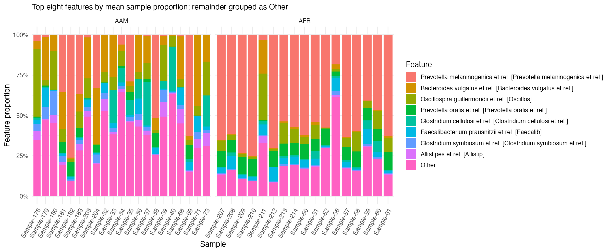
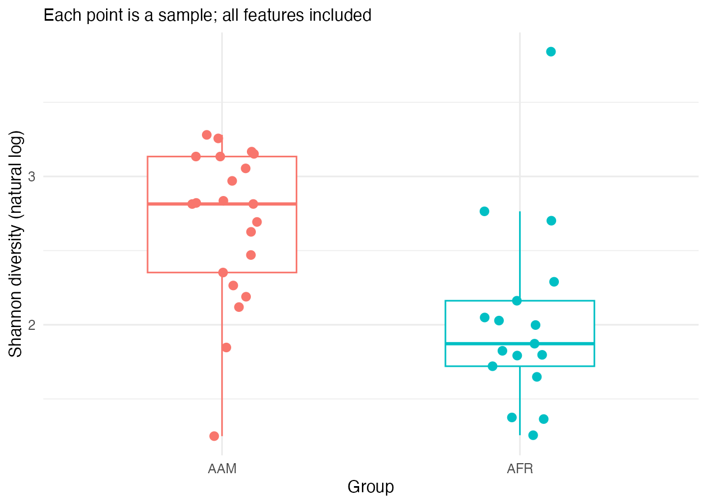
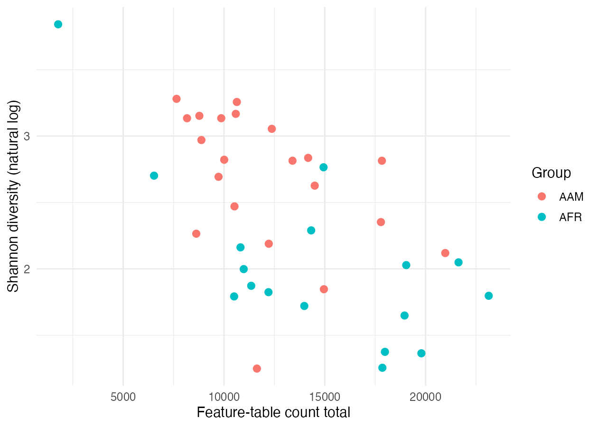

## Your task

Preview the supplied figures before running the workflow. Write one initial observation for each figure; you will check it against your own outputs after the run.

## Composition

Compare individual displayed features across AAM and AFR. Check the underlying proportions before naming a feature that appears different.

[Open the composition image at full size](../../results/dietswap/figures/composition.png) to read its labels.

## Shannon diversity

Read the group medians, spread, and overlap from your generated figure, then check them in the tables. For scale, the supplied reference checks give Shannon = 3.167035 for AAM sample Sample-32 and 2.028307 for AFR sample Sample-214. Both have 103 observed features, so their difference reflects the distribution of feature proportions. These two samples do not establish the direction of a group-wide difference.

## Count totals and diversity

Compare count ranges within each cohort and identify unusual samples. Check whether samples with similar count totals have different Shannon values.

::: {.callout-note}
These are descriptive plots. Composition bars sum to 100%; they do not show count totals. Visual differences alone do not establish statistical significance or causation.
:::

[Next: Meet the inputs](02-meet-the-data.qmd)
