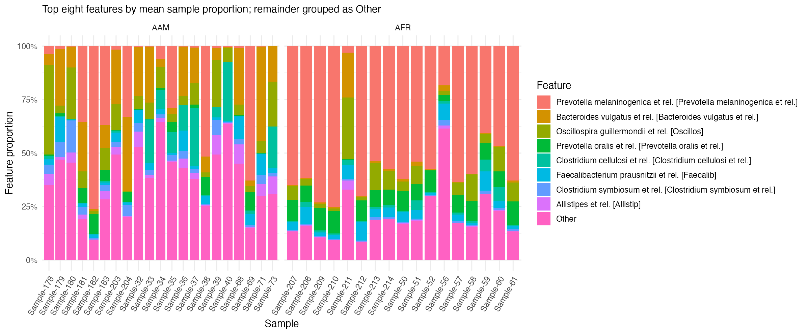
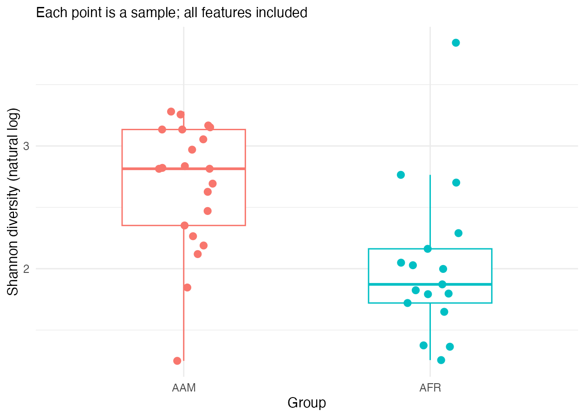
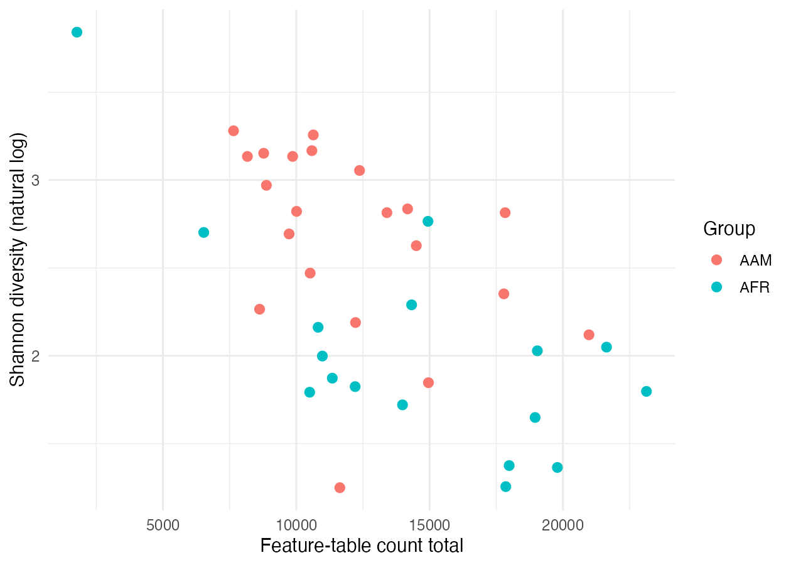

Optionally choose a sample from the study count table and apply the [independent sample check](../../01-run-the-workflow.qmd#independently-verify-one-sample), changing both paths to DietSwap. Confirm all three results agree.

## Optional sample checks

| Sample | Group | Total counts | Observed features | Shannon |
|---|---|---:|---:|---:|
| Sample-32 | AAM | 10585 | 103 | 3.167035 |
| Sample-181 | AAM | 17784 | 100 | 2.352228 |
| Sample-71 | AAM | 10521 | 102 | 2.470335 |
| Sample-214 | AFR | 19040 | 103 | 2.028307 |

Describe which displayed taxa vary, then check their proportions in the full table.

Compare the group medians, spread, and overlap. Check both observed richness and feature proportions before explaining the diversity values.

Describe the count ranges and any visible relationship with Shannon within each cohort.

Write a conclusion restricted to the selected samples and sampling stage. A comparison at one sampling stage does not estimate change after a diet swap.

[Next: Report the walkthrough](06-export-the-report.qmd)
