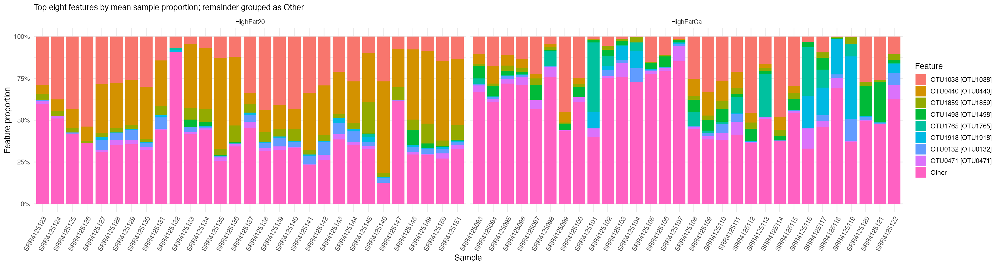
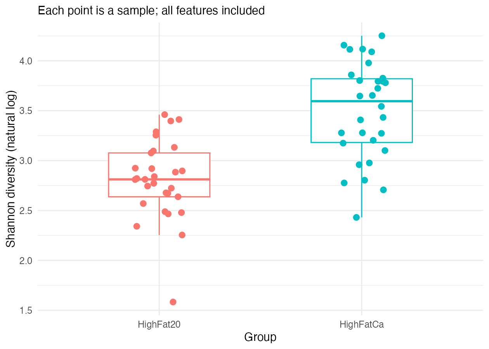
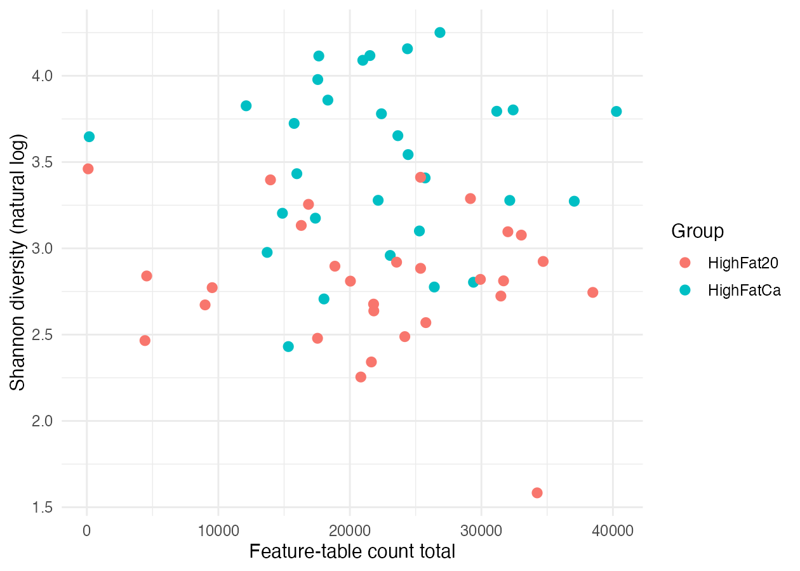

The figures below show the supplied results. Preview them now; you will use the shared workflow instructions to reproduce them after checking the inputs.

## OTU composition

OTU0440 generally occupies a larger proportion in HighFat20. HighFatCa has variable contributions from other displayed OTUs, and many samples have a larger pooled Other fraction. Other represents many OTUs, not one organism. Every bar sums to 100%, regardless of the original count total.

[Open the composition figure at full size](../../results/mouse59/figures/composition.png) to read the sample IDs and legend.

## Shannon diversity

The median Shannon value is higher in HighFatCa: **3.595117**, compared with **2.811773** in HighFat20. The distributions overlap. Shannon reflects both the number of observed OTUs and how evenly counts are distributed among them; higher values do not establish a healthier community.

## Count totals and diversity

Samples with similar count totals can have different Shannon values. Two samples have especially small totals, 99 and 182. The sample with the lowest Shannon value has a much larger total, so low counts alone do not explain every low diversity value. This scatterplot does not establish that count depth has no influence.

These observations describe the supplied data. The workflow does not test statistical significance or establish a treatment effect.

[Next: Meet the inputs](02-meet-the-data.qmd)
