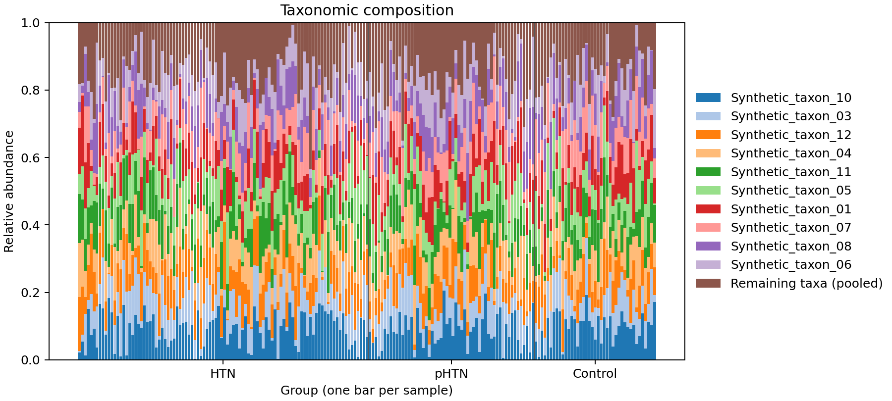
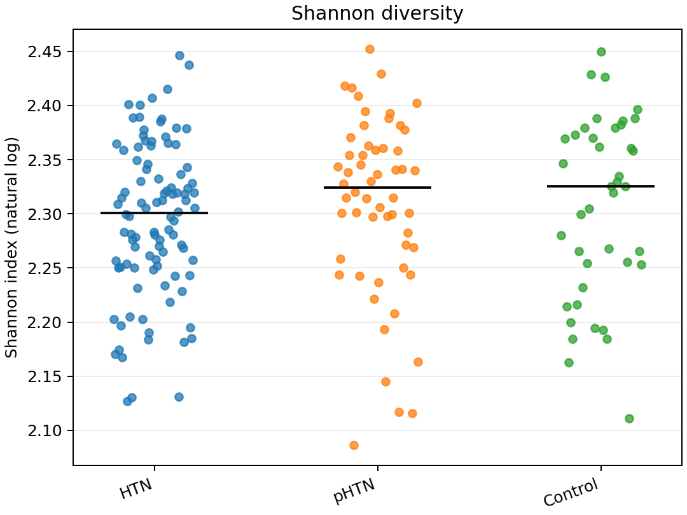
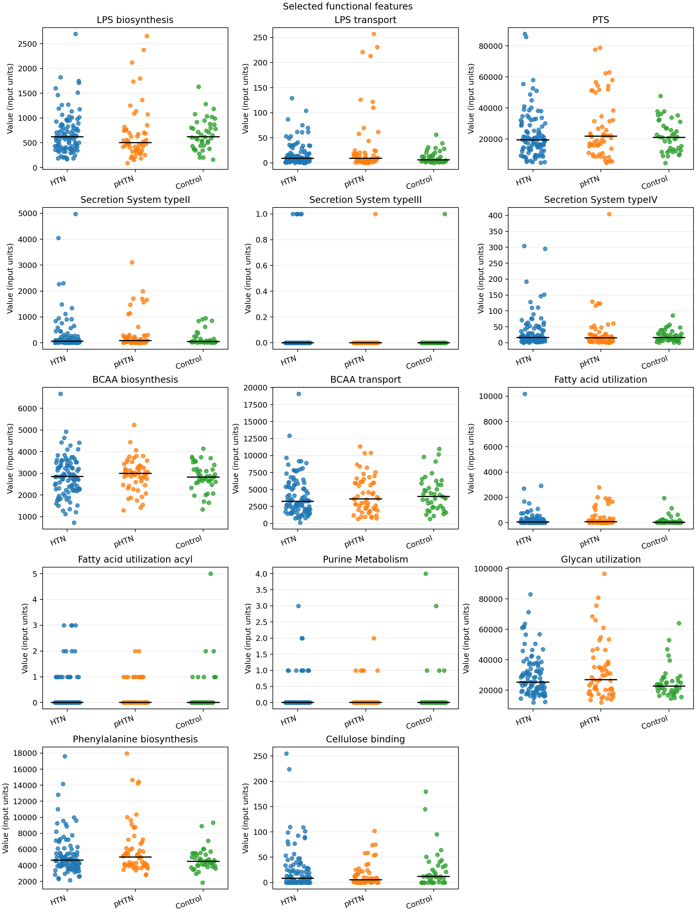

## Verify the bundled example

Find S01 in the sample-level Shannon table. It has two taxa at equal proportions, so its Shannon diversity is approximately 0.693147 using natural logarithms.

## Review the 195-sample workflow test

Compare the output sample counts with the input metadata. The test includes 41 controls, 56 prehypertension samples, and 98 hypertension samples.

::: {.callout-note}
The composition and Shannon figures use simulated taxon abundances. The functional figure uses the supplied CSV values, whose units and derivation still need verification.
:::

Each bar represents one sample. Compare the proportions within a bar and trace one segment back to the corresponding input row. The profiles illustrate how the workflow displays composition.

Each dot represents a sample and the black line marks the group median. Compare the spread and overlap to practice reading the plot. Any apparent group differences here reflect the simulated inputs.

Choose one feature and compare the group medians and spread within its panel. Check the medians against the summary table. Each panel uses its own scale, and these comparisons are descriptive.

[Next: Export the report](06-export-the-report.qmd).
