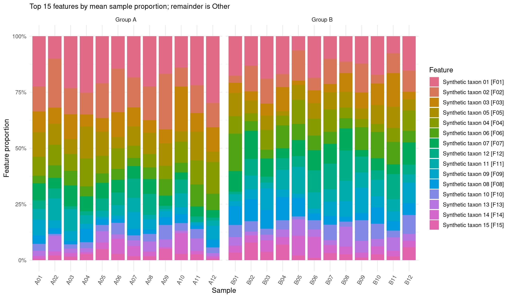
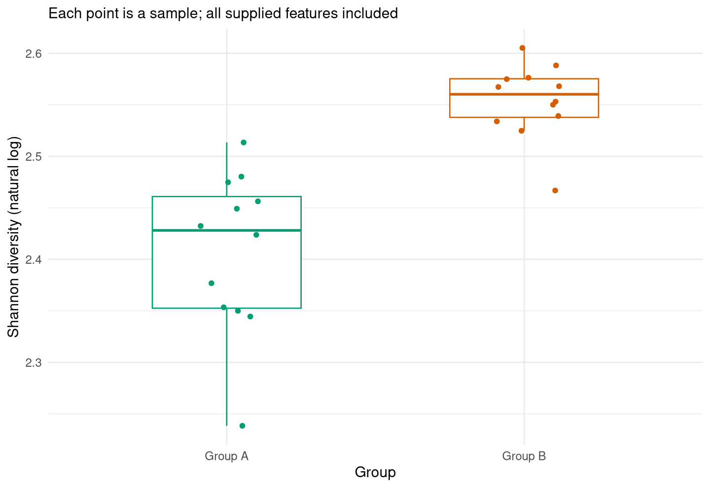
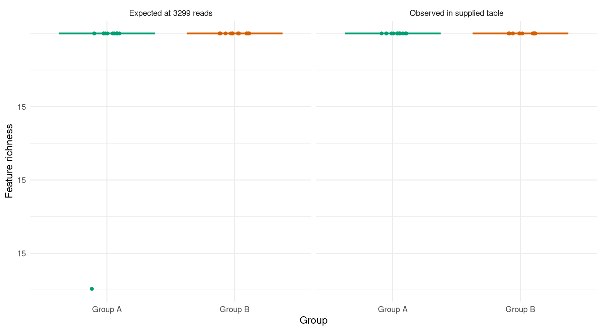
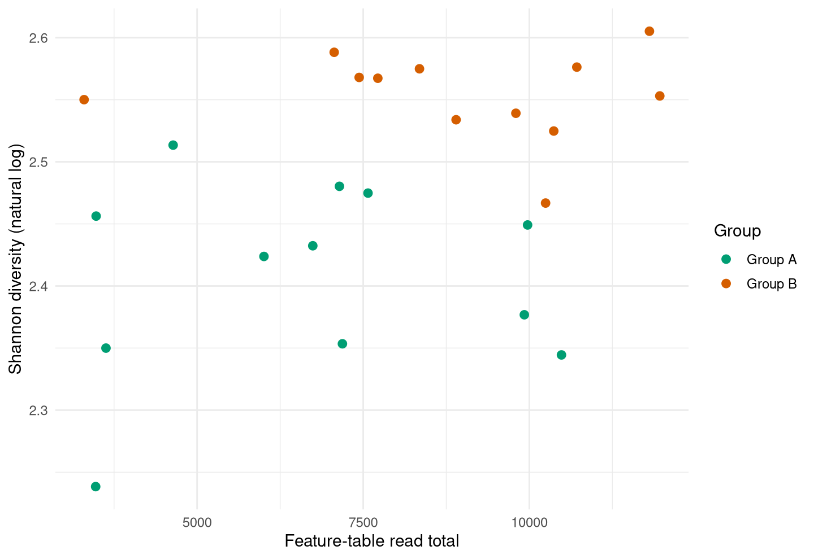
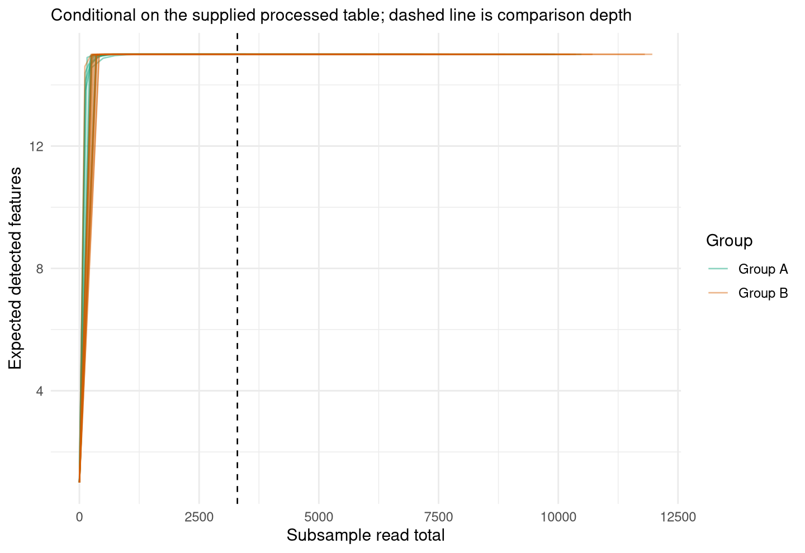
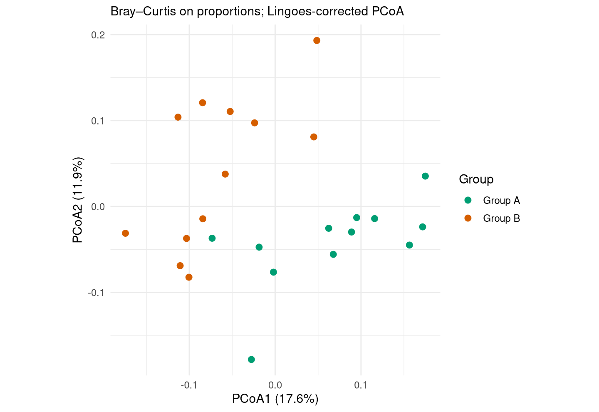
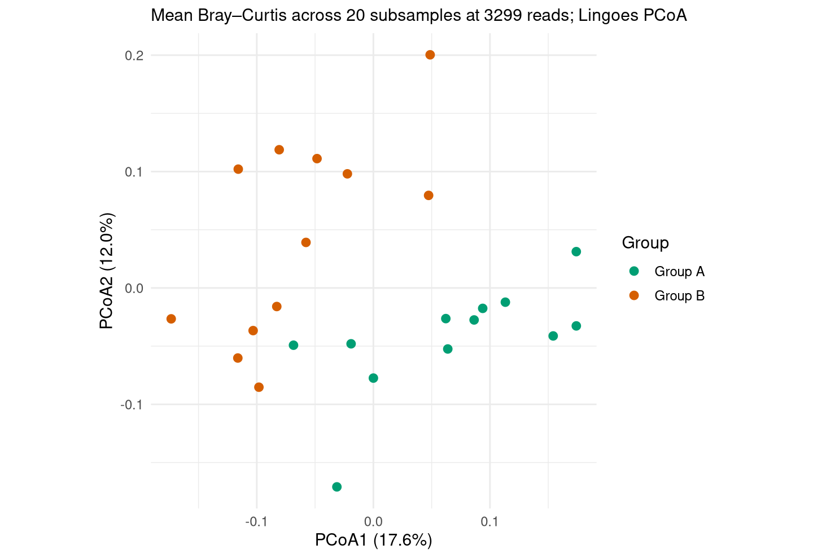
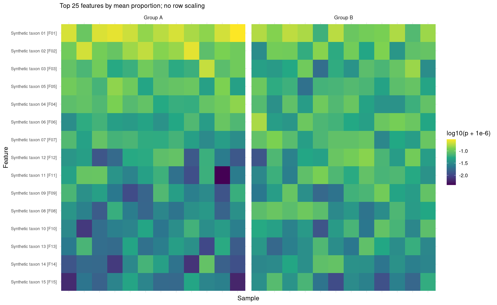
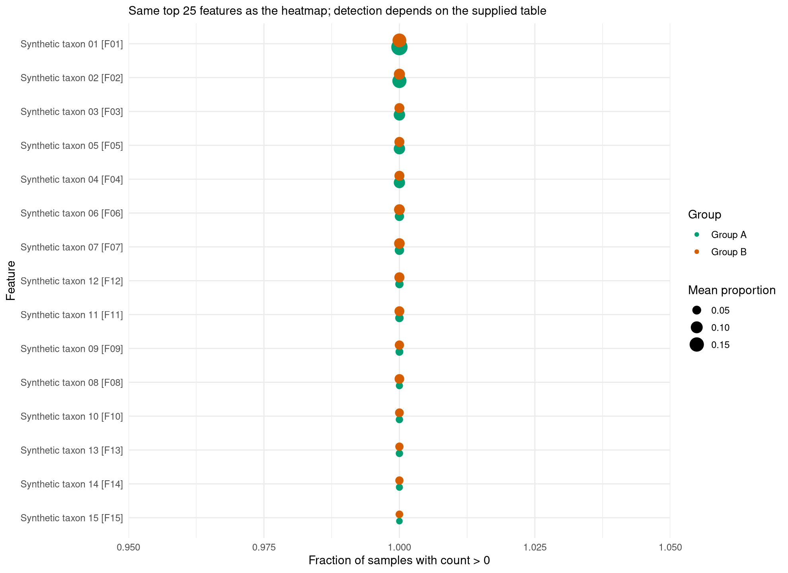

## Preview the questions before running

Write your own first observation before reading an AI explanation. The supplied
exploration figures are previews; rerun them and compare your own outputs.

All samples contain 15 detected fictional features. Any Shannon differences therefore concern their abundance distribution, rather than a difference in observed feature count.

## Composition

Which features contribute to each sample? This table has only 15 features, so all are displayed and there is no Other segment. In larger datasets, the remainder is pooled as light-grey Other.

## Shannon diversity

The supplied run gives median Shannon **2.428093** in Group A and **2.560208** in Group B. All samples contain 15 observed features, so the difference reflects their relative abundance distribution. These are fictional groups, not evidence about health.

## Observed and depth-standardised richness

Compare detected features with expected richness at the shared read depth.

## Read totals and diversity

Locate unusual samples; read total is not microbial biomass.

## Rarefaction curves

Check how detected-feature richness depends on subsample size within the supplied table.

## Community similarity

Nearby samples have more similar profiles under the specified distance; a gap is not a significance test.

## Depth sensitivity

Compare the group pattern with repeated equal-depth subsampling.

## Feature abundance heatmap

Read the log-colour scale. Darker or brighter colours are not differential-abundance results.

## Feature prevalence

Separate how often a feature is detected from its average relative abundance.

## Statistical plots come after inference

Inference creates a dispersion plot. For Zackular it also creates an ANCOM-BC2
volcano and effect-interval plot. Those results are introduced on Run and
Verify; do not infer discoveries from an exploration preview.

[Next: Meet](02-meet-the-data.qmd)
