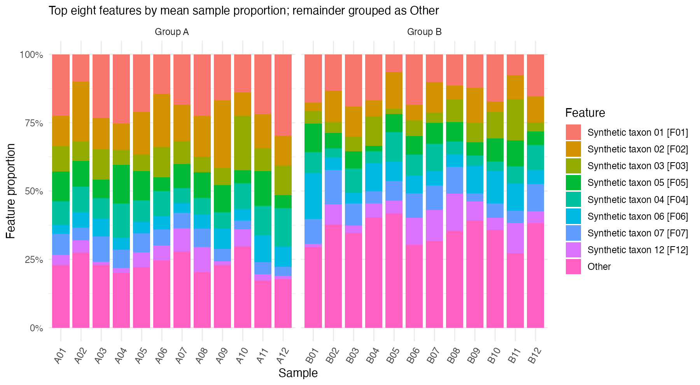
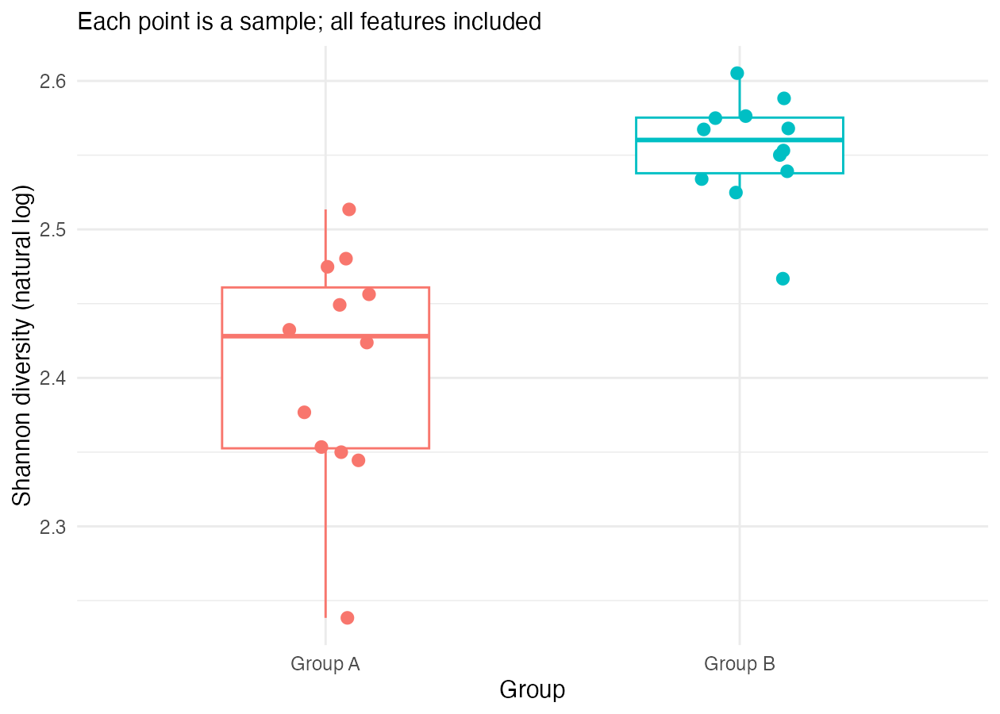
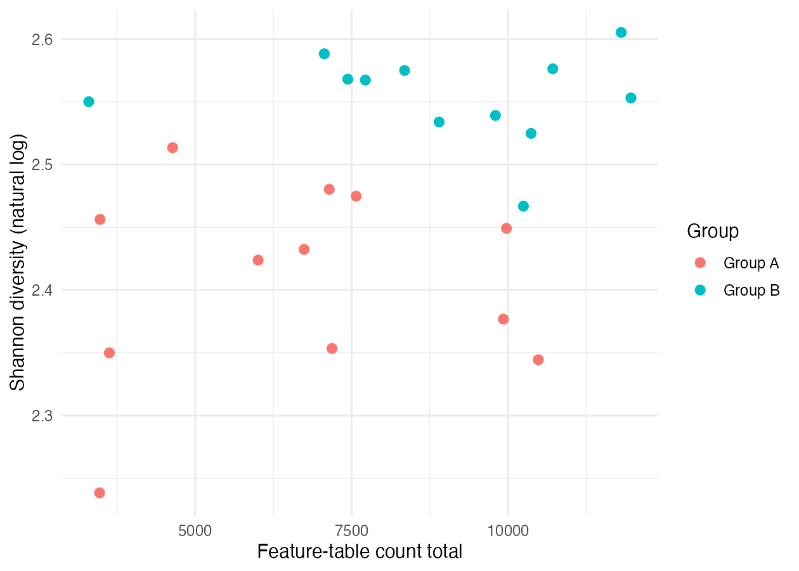

## Your task

Preview the supplied figures before running the workflow. Write one initial observation for each figure; you will check it against your own outputs after the run.

## Composition

The supplied composition figure shows a generally larger pooled Other fraction in Group B. Other pools seven fictional features, so its size does not identify which individual features contribute to the pattern. Check their proportions in the unpooled table.

[Open the composition image at full size](../../results/example/figures/composition.png) to read its labels.

## Shannon diversity

The supplied table has median Shannon values of about 2.428 in Group A and 2.560 in Group B. All samples have 15 observed features, so this difference reflects evenness in their feature proportions.

## Count totals and diversity

Compare count ranges within and between groups. Samples with similar totals can have different feature proportions and Shannon values.

::: {.callout-note}
These are descriptive plots. Composition bars sum to 100%; they do not show count totals. Visual differences alone do not establish statistical significance or causation.
:::

[Next: Meet the inputs](02-meet-the-data.qmd)
