## Preview the questions before running

Write your own first observation before reading an AI explanation. The supplied
exploration figures are previews; rerun them and compare your own outputs.

The supplied counts give median Shannon **3.790451** in Healthy and **3.570848** in Carcinoma, with broad overlap. Confirm these values in your run; they are descriptive summaries.

## Composition

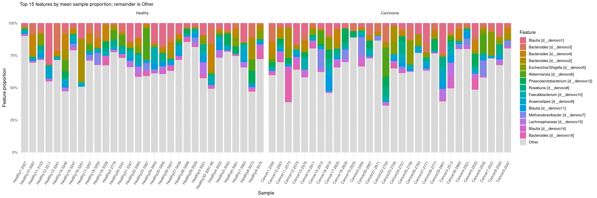

Which features contribute to each sample? Other is light grey; only display selection is reduced.

## Shannon diversity

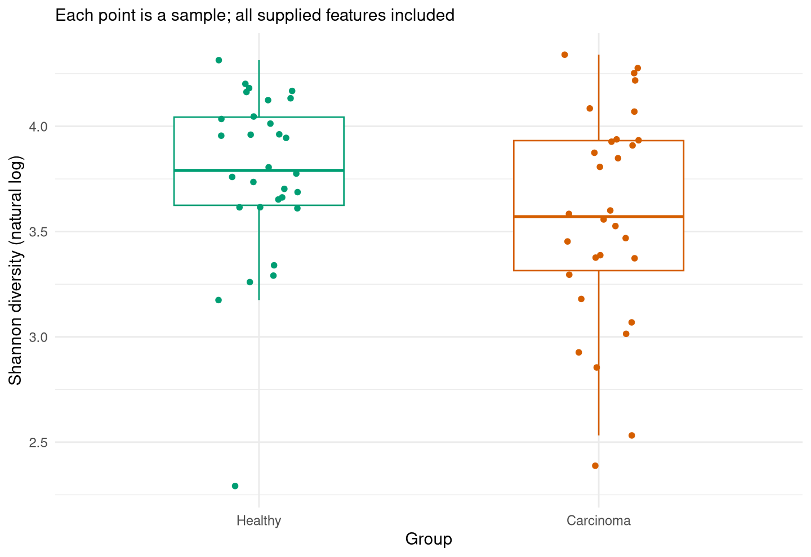

Compare medians, spread and overlap. A high value does not by itself mean better health.

## Observed and depth-standardised richness

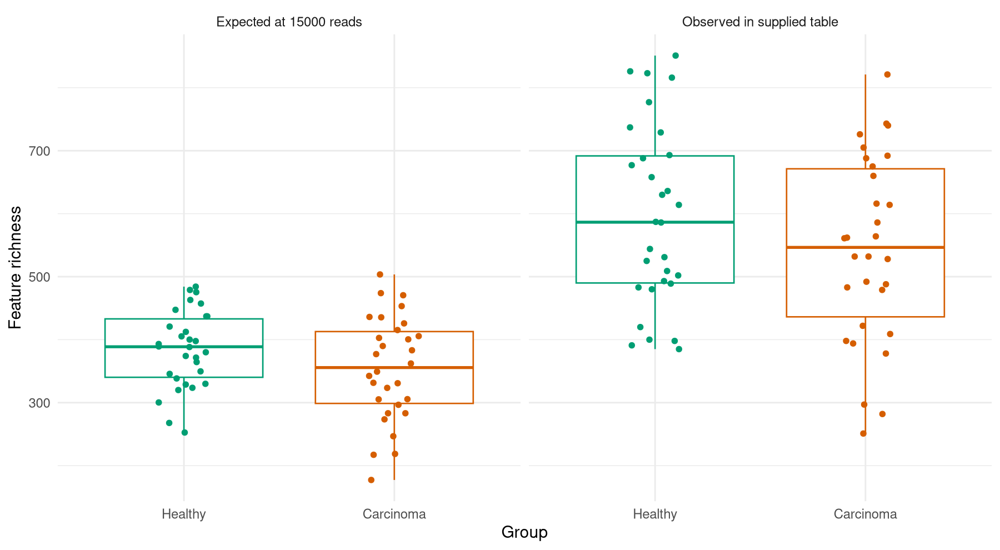

Median observed richness is **586.5 OTUs** in Healthy and **546.5** in Carcinoma. At 15,000 reads, median expected richness is approximately **388.8** and **355.7**, respectively. These are conditional processed-table summaries, not estimates of all species in the gut.

## Read totals and diversity

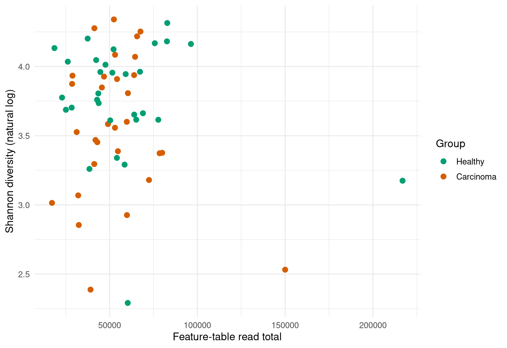

Healthy16-3251 has Shannon **2.291800** despite **60,335** retained reads. More reads do not guarantee greater evenness. Retained read total is not microbial biomass.

## Rarefaction curves

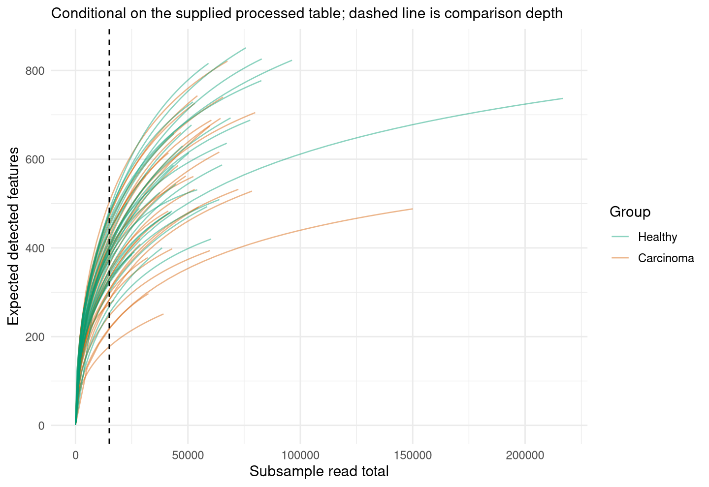

Check how detected-feature richness depends on subsample size within the supplied table.

## Community similarity

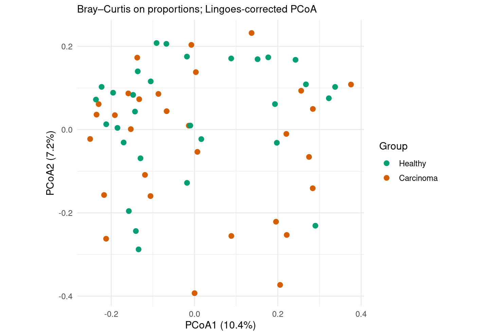

Healthy and carcinoma samples overlap in this two-axis view. The supplied run shows PCoA1 **10.4%** and PCoA2 **7.2%** of the corrected variation; most variation is outside these two axes. Check the full-distance test rather than treating overlap as proof of no association.

## Depth sensitivity

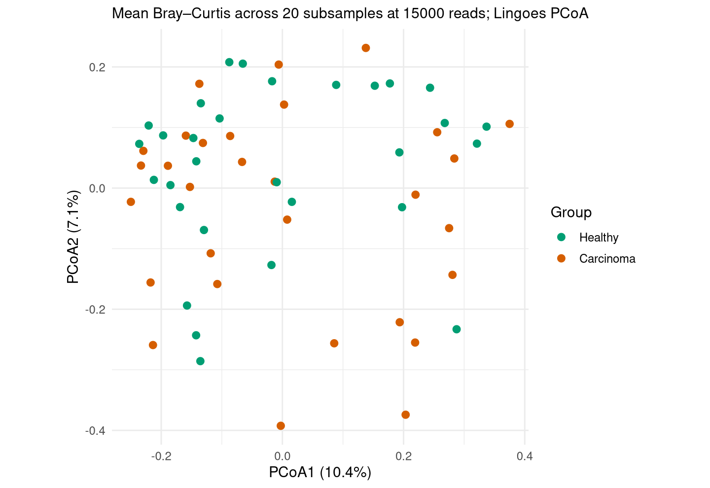

Compare the group pattern with repeated equal-depth subsampling.

## Feature abundance heatmap

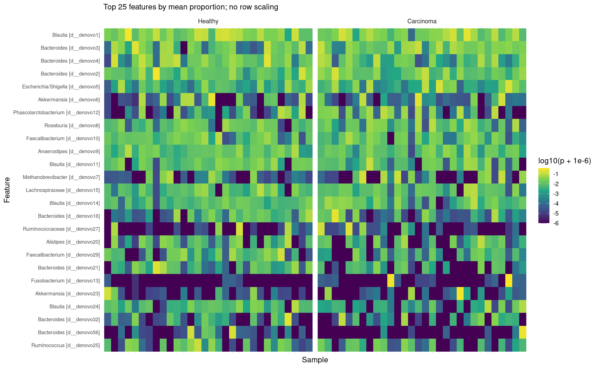

Read the log-colour scale. Darker or brighter colours are not differential-abundance results.

## Feature prevalence

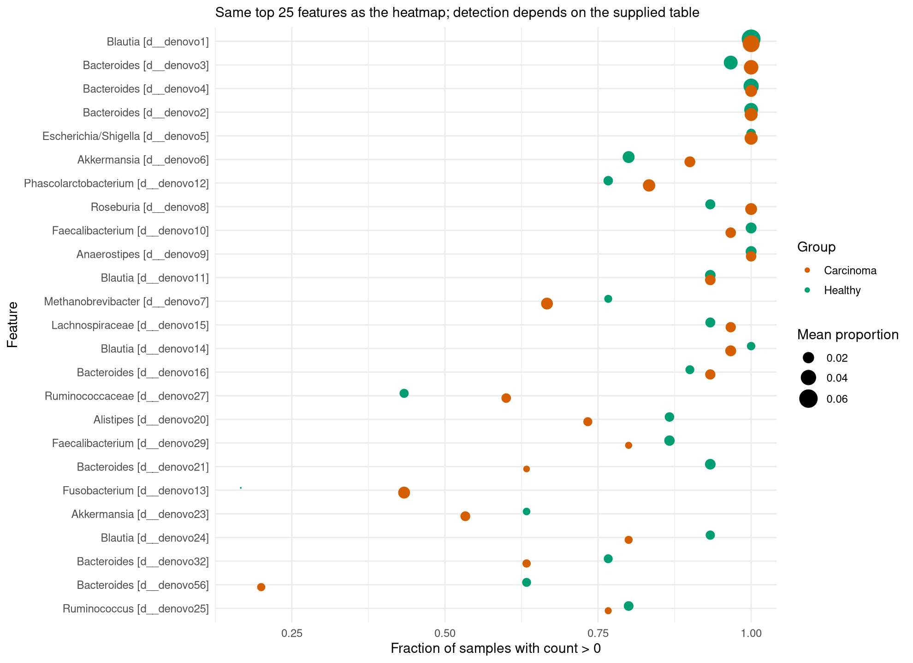

Separate how often a feature is detected from its average relative abundance.

## Statistical plots come after inference

Inference creates a dispersion plot. For Zackular it also creates an ANCOM-BC2
volcano and effect-interval plot. Those results are introduced on Run and
Verify; do not infer discoveries from an exploration preview.

## Dispersion and differential abundance

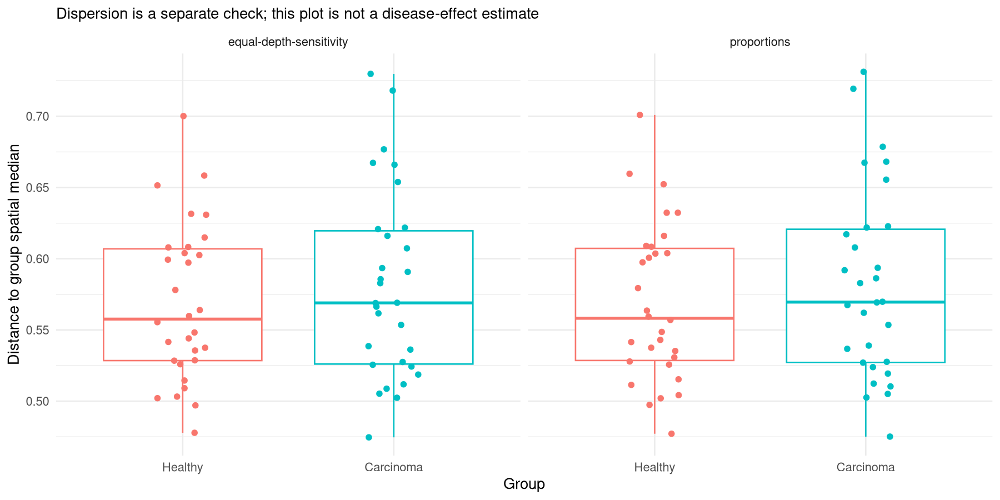

This checks variability around each group's spatial median, separately from
the adjusted community test. It does not adjust for age, sex or location.

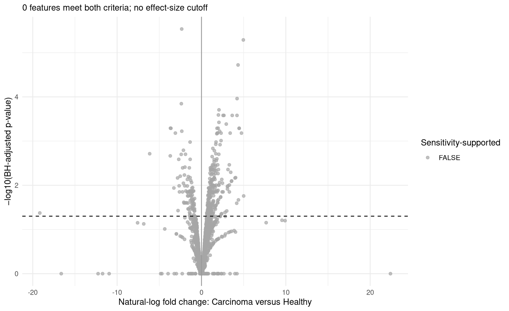

The supplied reference run has no sensitivity-supported discoveries. A point
above the adjusted-p threshold is not highlighted unless it also passes the
pseudo-count check. Missing model estimates are excluded from the plot.

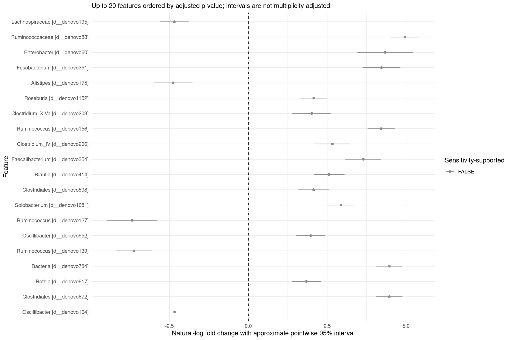

These are up to 20 features ranked by adjusted p-value, not 20 validated
biomarkers. Positive natural-log effects mean Carcinoma versus Healthy.
Intervals are pointwise and do not replace multiple-testing correction.

[Next: Meet](02-meet-the-data.qmd)
