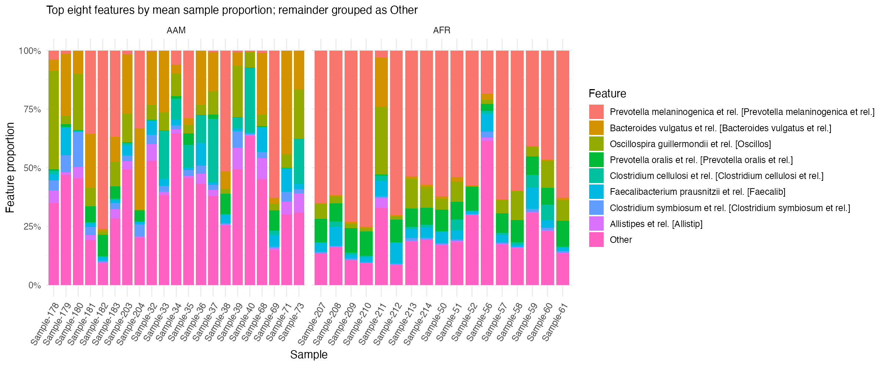

## Question and study design

Describe your question, groups, participants, and sampling stage.

## Data and decisions

Record input paths, source, sample counts, selection rules, and exclusions.

## Results

Insert a figure using the appropriate output path. For example:

```markdown

```

Report one numerical comparison checked against its table.

## Verification

Name the sample you checked and record its count total, observed features, and Shannon value.

## Interpretation and limitations

Explain what the result supports and the limits of your comparison.

## Reproducibility and AI assistance

Record the commands, output path, R session information, and suggestions you checked.
