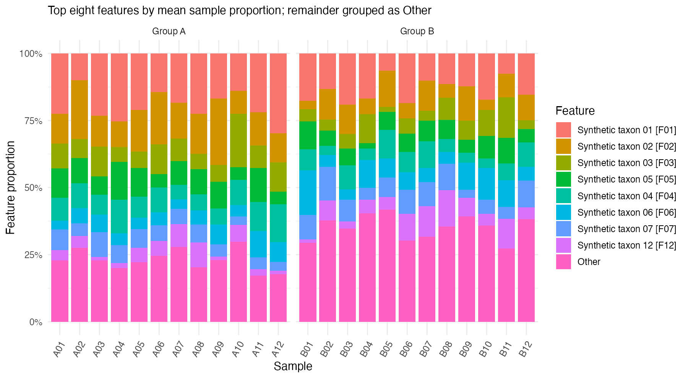
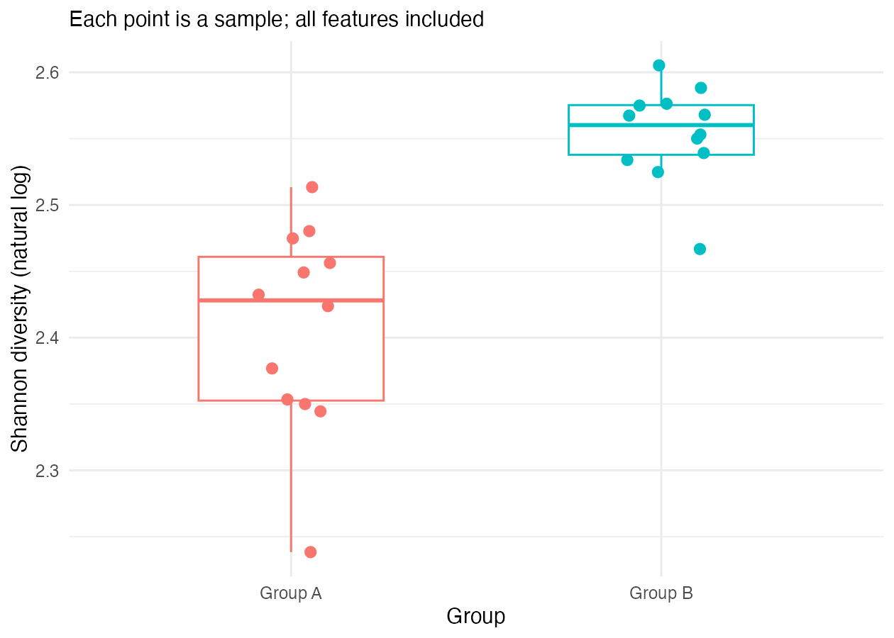
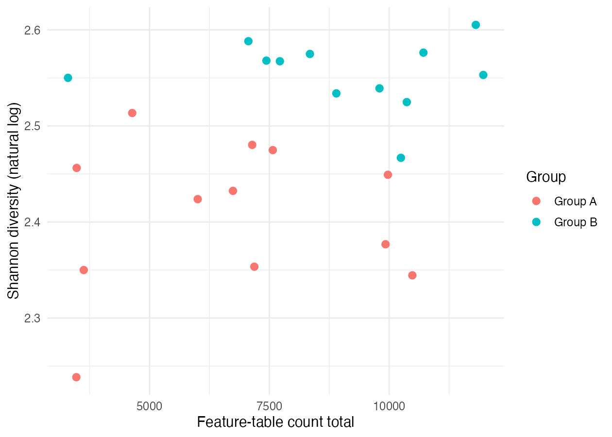

## Question and inputs

How do community composition and diversity differ between two groups? This synthetic dataset contains 24 samples, 12 per group, and 15 fictional features. Feature-table totals range from 3299 to 11964. These totals are not verified raw sequencing depth.

## Methods

Validate identifiers and counts, calculate sample feature proportions, observed richness, and Shannon diversity using natural logarithms. The composition display retains the top eight features by mean sample proportion; all others become Other. Diversity uses all 15 features. No inferential tests are performed.

## Results

| Group | Samples | Median Shannon | Minimum | Maximum |
|---|---:|---:|---:|---:|
| A | 12 | 2.428 | 2.238 | 2.513 |
| B | 12 | 2.560 | 2.467 | 2.605 |

Both groups show within-group variation and overlapping diversity ranges. The descriptive median is higher in Group B in this constructed example.

Inspect totals alongside diversity. This plot alone cannot establish whether sampling effort affects the estimates.

::: {.cdi-message}
**Defensible finding:** The synthetic groups show variation in composition and diversity, with overlapping values. The figures summarize observations; they do not test a biological hypothesis.
:::

## Verification

A01 contains 6006 feature counts and 15 observed features. Dividing counts by the total and calculating $-\sum p_i\ln(p_i)$ over positive proportions gives **2.423797**. Every sample’s feature proportions sum to one.

Included tables were independently calculated from the counts. R execution and Quarto rendering were unavailable during this update; rerun both locally and compare numerical outputs before accepting the report.

## Limits and conclusion

::: {.callout-note}
These are synthetic data. Higher diversity does not imply better health, and visual group differences do not establish significance or causation. Real studies require review of sampling effort, filtering, contamination, study design, and suitable statistical methods.
:::

## AI assistance

AI assisted in constructing the teaching dataset, drafting scripts, and explaining results. Calculations and input consistency were checked independently. The learner must rerun the workflow, review its figures, and verify the final interpretation.
